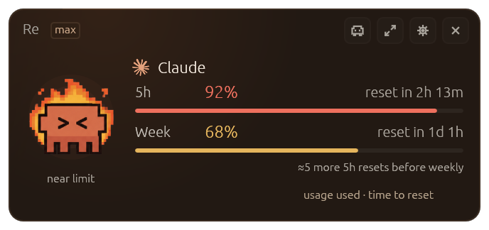

# Features

What Clauddy shows and does: the panel, its sizes, the pet's moods and what the pet says.

## The panel

| Row | What it shows | Source |
|---|---|---|
| Current session | Real % used, `resets in Xh Ym`, session tokens, and where the pace is taking you ([burn rate](04-usage.md#burn-rate)) | Account % · local logs |
| Weekly · all models | Real % used and tokens over the last 7 days | Account % · local logs |
| Status line | `● working · 1.6M tok/min`, or today's tokens when idle | Local logs |
| By model · 7 days | Opus, Sonnet, Haiku, Fable, in tokens | Local logs |
| By project · 7 days | Which repo used the week, ranked, the tail folded into `other` | Local logs |
| 30-day map | One square per day, green (light) to red (heavy), with the monthly total | Local logs |

Everything is in tokens and percent, never in dollars. Without a connected account the limits area asks to connect instead of guessing a % ([usage](04-usage.md)).

## Sizes and controls

| Size | What it is | How to get there |
|---|---|---|
| Expanded | The scene, the session, the week and the details | The default; **⤢** from compact |
| Compact | The pet in a ring of the live session %, or one line per service when more than one is connected | **–** in the title bar |
| Just the pet | The pet alone, floating; hovering it (or focusing it) shows the usage as the pet's own speech bubble, one bar per service | The pet icon in the compact header (floating mode only) |

- **Drag** the widget anywhere; in pet-only mode drag the pet itself. Enter on the focused pet opens compact.
- **⚙** opens Settings: **Accounts**, **Alerts** and **Appearance** tabs; a dot on it means an update is out.
- **↗** opens the official Usage page of the service on screen. **×** quits.
- **Notify at reset**, under the session, arms a one-shot notification for when the session resets ([alerts](05-alerts.md)).
- The chosen size is remembered.

### Floating or menu bar

**⚙ Settings → Appearance → Lives in** picks where Clauddy lives:

- **Floating**: the always-on widget in a corner (the default).
- **Menu bar**: a pet icon in the menu bar with the hottest session % beside it (🔥 near the limit). Its menu opens the panel under the icon, switches back to floating or quits; a click away closes the panel, and **–** in its title band hides it. On Windows and Linux the icon lives in the system tray and the % shows in its tooltip.

Switching takes effect at once, with no restart.

### The menu

The menu leads with the limits, grouped under a header per service (Claude, Codex, Cursor). On macOS each limit is one monospaced row: its name, a ten-cell bar, the percent and its reset; the 5-hour rows add the time left (`4h 7m · 3:50 AM`). A row turns amber at the first heads-up threshold and red at the fire threshold, the same lines as the alerts and the 🔥. A long window whose reset is more than eight days out is labelled **Limit** rather than **Week**. One row sums the API-rate value for today, 7 days and 30 days; **Details** holds the per-service split and the fine print (partial estimates, that the value is not billed, the projected 5-hour windows before the weekly reset). The rows are enabled so macOS doesn't dim them; a click on one only closes the menu. Windows and Linux show the same rows as plain text, without bars. The menu is rebuilt only when what it shows changes.

### Wall display

**Wall display** in the menu serves a read-only page on the local network for a spare screen, such as an old iPad on a stand ([ADR-015](../decisions/ADR-015-wall-display-on-the-local-network.md)). It is off until switched on and remembered across restarts. While on, the menu shows its address by IP and by the Mac's `.local` name, and **Copy wall display link** puts it on the clipboard.

The page answers one question from across the room, can I keep coding: a line across the top (**All clear**, **Watch your pace**, **Slow down**, or **out** with the wait and which service still has room), and a card per service led by the limit that stops you first. Each bar has a tick where an even spend would be by now; past it, the card says **ahead of pace** and when, at that rate, the limit runs out. A limit at 100% turns its card into a countdown to the reset. The page tints amber or red with the state, shows the pets in their mood (working, idle, on fire, tired when out, asleep when the reading is stale or signed out) and ends with the API-rate value. It is plain HTML and CSS that reloads every minute, with no JavaScript, so a decade-old Safari shows it.

## Moods

| | | |
|---|---|---|
|  |  |  |
| **idle**: breathes and blinks | **working**: types at the desk | **on fire**: session past the fire threshold (90% by default), flames |

**Maxed out** (the session at 100%) slumps and sweats, and **sleeping** (idle 5+ minutes) closes its eyes under a "Z z". The pictures come from the snapshot gallery in `native/tests/snapshots/`, which has every state; the other pets have every mood in their own look ([pets](06-pets.md)).

In compact and pet-only sizes the mood follows whichever connected service is working, with provider logos naming the workers. With none active, the hottest session sets the mood: on fire past the fire threshold, maxed out at 100%, resting otherwise; the logo of the service on fire takes the status dot's place. "Working" means a turn is open, not that a file was written recently ([ADR-006](../decisions/ADR-006-working-means-an-open-turn.md)). What Claude is doing (reading, editing, running, planning, researching, delegating, waiting) shows in the status line.

## The pet talks

Now and then the pet says something in a speech bubble. It speaks only when something changes, never on a timer, and keeps quiet when it has nothing specific to say. Remarks are at least 10 minutes apart; the big moments can cut that line.

| Moment | Expanded | Minimized | Blip |
| --- | --- | --- | --- |
| First launch of the day | _Good morning! Yesterday was your heaviest day this week, 12M tokens._ | _Morning! Big day yesterday._ | ✓ |
| Session crosses the fire threshold | _Getting warm, 91% already. At this pace you'll run out in about 40m._ | _91%, getting warm!_ | ✓ |
| The session window resets | _Fresh window! That was 34M tokens over 4h 12m, mostly editing code._ | _Fresh window! 34M last time._ | ✓ |
| The session hits 100% | _That's the limit. I'll be back at 2:35 PM._ | _Maxed out till 2:35 PM._ | |
| Back after 2+ hours away | _Welcome back! You were gone 3h 12m. The session's at 12%._ | _Welcome back!_ | |
| 90 minutes of unbroken work | _You've been at it for 1h 35m straight. Stretch break?_ | _Stretch break?_ | |
| A new record day (30-day best) | _New record! 45M tokens today, your biggest day in a month._ | _New record: 45M!_ | |
| Codex crosses fire, hits 100% or resets | _Codex is at 91% now. It resets in 1h 12m._ | _Codex at 91%!_ | ✓ (fire, reset) |
| Cursor crosses fire, hits 100% or starts a new month | _Cursor is at 91% now. It resets in 6d 4h._ | _Cursor at 91%!_ | ✓ (fire, reset) |

The greeting follows the clock (_Good morning_, _Good afternoon_, _Good evening_, or _Still up?_ before 5 AM) and comes once a day, as does the record. The reset recap covers only what the pet saw, so launched mid-session it says less. A click dismisses the bubble.

### The voice

Optionally the pet **blips** as it talks: short chiptune notes, one per letter, made live (square waves, no sound files). macOS only for now. Faster and higher on fire, slower and lower when sleepy. Only the headline moments blip (the ✓ rows), because a sound on every remark wears out fast.

- **Off by default.** **⚙ Settings → Appearance → Chiptune voice** turns it on and plays a sample.
- **Always silent** in menu-bar mode and outside the expanded size.

**Speech bubbles** can be turned off in the same place.
